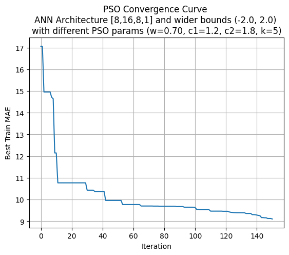
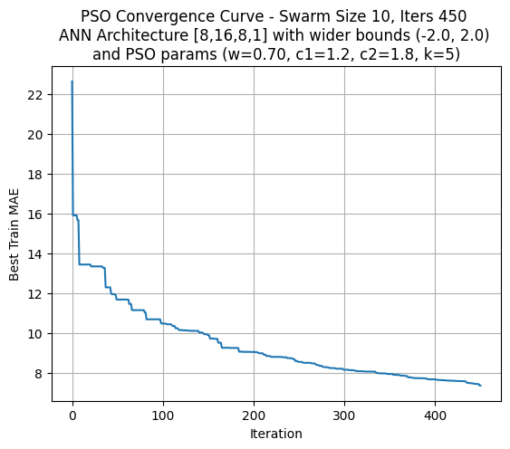
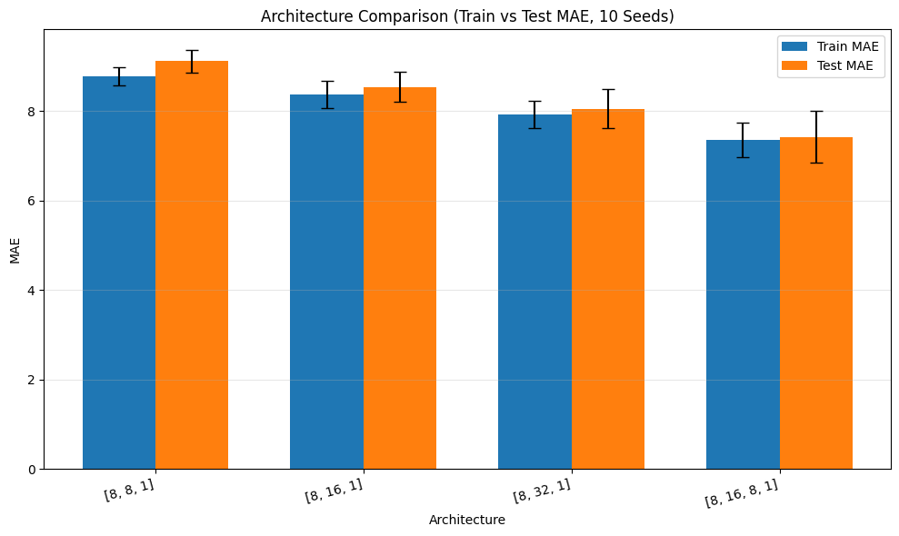
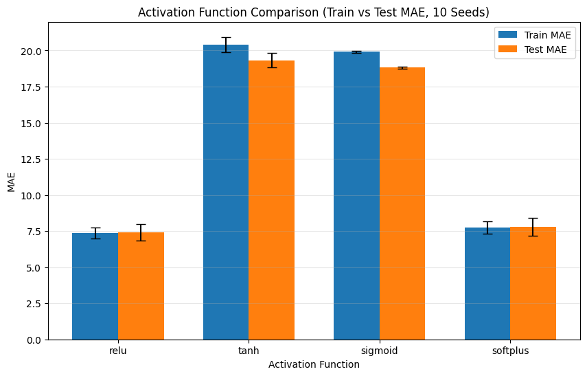

# Training a neural network with particle swarm optimisation

Collaborative MSc Artificial Intelligence coursework for F21BC Biologically Inspired Computation. The project implements a feedforward artificial neural network (ANN) and particle swarm optimisation (PSO) from scratch using NumPy. It investigates whether PSO can train an ANN to predict concrete compressive strength, and how network architecture, hidden activations, search bounds and swarm settings affect the observed error.

## Method

The ANN applies an affine transformation followed by an activation at each layer. It takes eight standardised inputs and returns one strength estimate through a linear output. The coursework compares ReLU, tanh, sigmoid and softplus in the hidden layers.

Each PSO particle encodes the ANN's weights and biases in a flat vector, with each layer's weights followed by its biases. The fitness function loads those parameters into the network and computes mean absolute error (MAE) on the training set. The optimiser updates each particle's velocity using inertia, its personal best and the best personal best among its fixed informants. Each particle is its own informant. A coordinate that crosses a boundary is reflected, its velocity is reversed, and its position is clipped if the reflection still lies outside the bounds. The swarm records its best candidate for evaluation. Training uses no backpropagation.

The activation-optimisation extension appends one continuous coordinate per hidden layer to the same vector. A negative coordinate selects ReLU and a nonnegative coordinate selects softplus. For the `[8, 16, 8, 1]` architecture, this increases the search dimension from 289 to 291. The output activation remains linear.

## Dataset

[The bundled CSV](data/concrete.csv) contains 1,030 observations. Its predictors are cement, blast-furnace slag, fly ash, water, superplasticiser, coarse aggregate and fine aggregate (all in kg/m³), plus age in days. The target is compressive strength in MPa. The CSV uses simplified headers and less numeric precision than the UCI spreadsheet.

The notebook uses a fixed, shuffled 70/30 split (seed 0), with 721 training rows and 309 test rows. Input standardisation uses means and standard deviations fitted on the training rows. The target stays in MPa.

Dataset credit goes to I-Cheng Yeh (1998), *Concrete Compressive Strength*, UCI Machine Learning Repository. UCI permits sharing and adaptation with attribution under CC BY 4.0. [Dataset and DOI](https://doi.org/10.24432/C5PK67) · [CC BY 4.0](https://creativecommons.org/licenses/by/4.0/)

## Repository structure

| Path | Contents |
| --- | --- |
| [ann/](ann/) | Feedforward ANN and activation functions |
| [pso/](pso/) | Informant-based particle swarm and boundary handling |
| [coupling/](coupling/) | ANN fitness and conversion between parameter vectors and network tensors |
| [experiments/](experiments/) | Data loading, prediction, MAE and the original experiment notebook |
| [data/concrete.csv](data/concrete.csv) | Dataset as used in the coursework |
| [run_checks.py](run_checks.py) | ANN, parameter conversion and random-weight baseline smoke checks |
| [docs/plots/](docs/plots/) | Selected PNGs extracted from the original notebook outputs |

## Run locally

Use Python 3.12 and run the following commands from the repository root. The installation retains the original coursework package pins.

```sh
python -m venv .venv
```

Activate the environment with `.\.venv\Scripts\Activate.ps1` in PowerShell or `source .venv/bin/activate` in Bash.

```sh
python -m pip install -r requirements.txt
python -m pip check
python run_checks.py
```

For a full run, install the notebook runner and write the results to an ignored directory. The kernel runs from `experiments/` so the notebook can resolve its relative data and import paths. The seed sweeps can take tens of minutes.

```sh
python -m pip install nbconvert==7.17.2
python -m jupyter nbconvert --to notebook --execute --ExecutePreprocessor.kernel_name=python3 --ExecutePreprocessor.timeout=-1 --output test-reproduced.ipynb --output-dir .reproduction experiments/test.ipynb
```

## Saved results

The values below come from the coursework [notebook](experiments/test.ipynb). Error is measured in MPa.

| Single-run experiment | Train MAE | Test MAE |
| --- | ---: | ---: |
| Random-weight ANN | — | 34.862 |
| Initial PSO, `[8, 16, 1]` | 19.717 | 18.504 |
| Initial PSO, `[8, 32, 1]` | 16.188 | 15.118 |
| Initial PSO, `[8, 16, 8, 1]` | 13.367 | 12.801 |
| Wider bounds (−2, 2), `[8, 16, 8, 1]` | 9.728 | 9.998 |
| Adjusted PSO coefficients, 30 particles × 150 iterations | 9.101 | 9.575 |
| Same coefficients, 50 particles × 90 iterations | 10.692 | 10.317 |
| Same coefficients, 10 particles × 450 iterations | 7.365 | 7.407 |
| Training-fitness early-stopping trial | 7.365 | 7.407 |

The three initial PSO runs used ReLU hidden layers, 30 particles, 150 iterations and parameter bounds of −1 to 1. The wider-bounds trial kept the original coefficients. The next trial changed the coefficients and the number of informants together.

The 30 × 150, 50 × 90 and 10 × 450 allocations each had 4,500 evaluations during updates, plus one initial evaluation per particle. These plots show the best training MAE recorded from initialisation through the final iteration.





The sweeps report mean ± standard deviation across ten optimiser seeds (0–9) on the same data split. With fixed ReLU activations, the four architectures achieved mean test MAEs of 9.114, 8.544, 8.050 and 7.426 MPa in the order shown below. The best observed configuration in the five-setting PSO grid used inertia 0.70, cognitive coefficient 1.2, social coefficient 1.8 and five informants. For this configuration and architecture, the ten-seed test MAE was 7.426 ± 0.572 MPa.



| Hidden activation on `[8, 16, 8, 1]` | Train MAE | Test MAE |
| --- | ---: | ---: |
| ReLU | 7.351 ± 0.386 | 7.426 ± 0.572 |
| tanh | 20.411 ± 0.528 | 19.327 ± 0.506 |
| Sigmoid | 19.912 ± 0.082 | 18.809 ± 0.083 |
| Softplus | 7.737 ± 0.436 | 7.775 ± 0.624 |
| ReLU or softplus selected by PSO for each layer | 7.427 ± 0.440 | 7.575 ± 0.453 |



Fixed ReLU had the lowest mean test MAE among the tested activation methods on this split. The original activation-comparison printout says five seeds. Its loop and saved plot both use ten.

The portfolio audit reproduced the reported concrete MAEs at their saved precision and matched all 11 plot PNGs byte for byte. The separate sphere smoke test has an unresolved archival discrepancy. The earliest committed code returns 0.778606 after 20 steps in the recorded Python version with the pinned NumPy version. The archive reports 0.284060. [Sphere investigation](docs/reproducibility.md#sphere-benchmark-investigation)

## Research limitations

- The same test split was consulted for architecture, activation and hyperparameter comparisons. Reported results are descriptive for that split, and the best observed score may be optimistic after comparison. There was no separate final holdout or nested evaluation.
- The early-stopping trial tracks the swarm's best **training** MAE with a patience of 20 iterations. The archived output calls it `val MAE`. No independent validation set was used, and the recorded run reached the 450-iteration limit.
- Seed variation measures optimiser variability on one fixed split. Nine test rows have exact duplicates among the training rows. Alternate splits, duplicate-aware evaluation and external datasets were outside the coursework scope.
- The baseline uses randomly initialised weights. The coursework did not benchmark a gradient-trained ANN or standard regression models, so it does not establish a comparative advantage for PSO.

## Contributions and licensing

- **Nimijith (GitHub `NIMIJITHNJ`)** authored the commits for the baseline ANN and data/evaluation pipeline, informant PSO and ANN coupling, experimental comparisons, activation-search extension, final notebook comment updates, and addition of the coursework copy of Yeh's dataset. [Baseline ANN](https://github.com/Anusree-K19/F21BC-Biologically-Inspired-Computation/commit/3f093aa) · [PSO and coupling](https://github.com/Anusree-K19/F21BC-Biologically-Inspired-Computation/commit/f9aeeb6) · [Comparisons and activation search](https://github.com/Anusree-K19/F21BC-Biologically-Inspired-Computation/commit/26e04ca) · [CSV addition](https://github.com/Anusree-K19/F21BC-Biologically-Inspired-Computation/commit/28eaef8) · [Notebook comments](https://github.com/Anusree-K19/F21BC-Biologically-Inspired-Computation/commit/83baaa5)
- **Anusree-K19** authored the initial repository commit, which added the project description. [Initial commit](https://github.com/Anusree-K19/F21BC-Biologically-Inspired-Computation/commit/467faa0)

These credits describe contributions visible in Git. Work such as offline collaboration, discussion and review may be absent from that record.

The coursework repository has no explicit software licence. The dataset licence covers the dataset. Reuse or redistribution of the collaborative code, notebook or figures should be agreed with the relevant rights holders.
